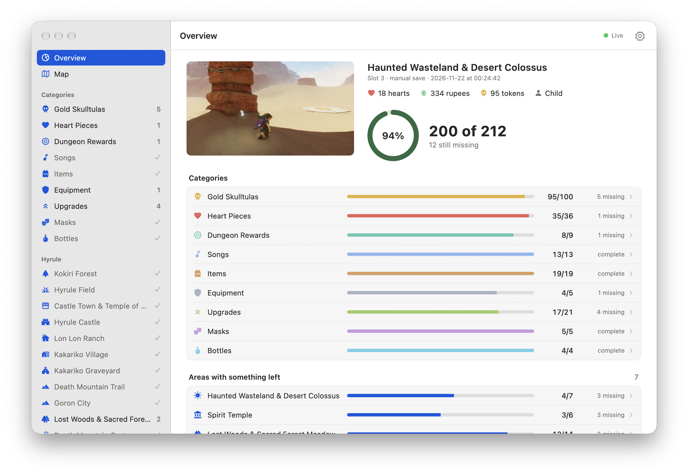
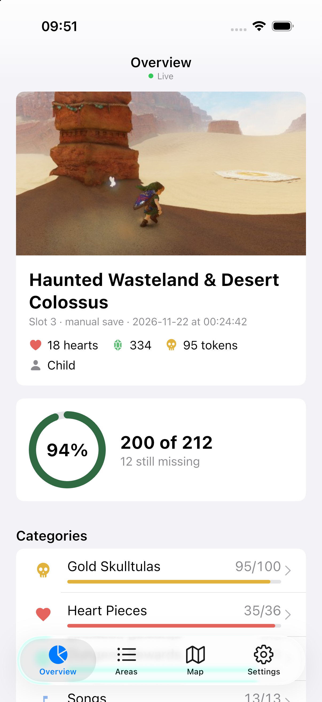
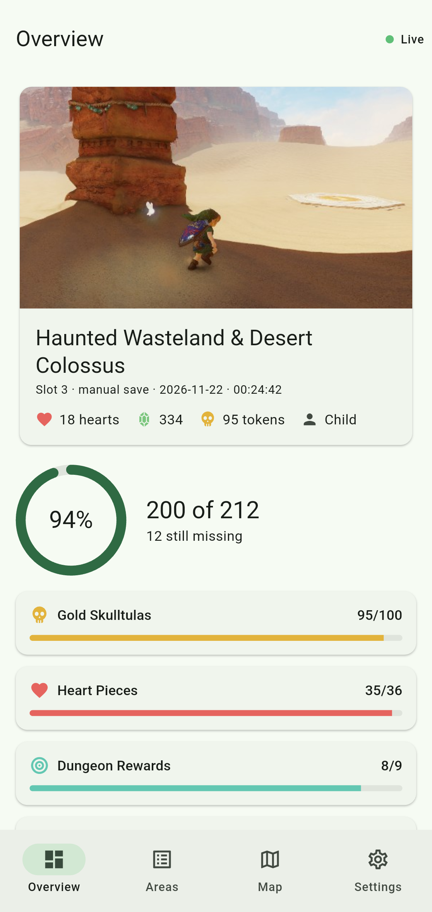

<p align="center">
  
</p>

<h1 align="center">OoT Auto Tracker</h1>

<p align="center">
  An automatic progress tracker for the Ocarina of Time remake (Switch 2)
</p>

<p align="center">
  <a href="https://github.com/CedricKassen/OOT-Remake-Auto-Tracker/releases/latest">Download</a> ·
  <a href="RELEASING.md">Install notes</a> ·
  <a href="#run-it-from-source">Build from source</a> ·
  <a href="https://ko-fi.com/kassensystems">Support on Ko-fi</a>
</p>

<p align="center">
  
</p>

The application is split into two parts. A Server that runs on your computer and is reading the
save file, and a Client that runs on any device to show your progress.

- **Spoiler-free mode** You see how many things are missing per area
  and category, not which ones or where. Switch it off to get every entry
  with its location.
- **Interactive Hyrule Map**, drawn with the game's own artwork from your copy of
  the game, with a pin for every Gold Skulltula and Heart Piece.
- **Native Applications** The app is build in flutter and contains native frontends for every client.
- **Read-only.** The server never opens a save file for writing.

<p align="center">
  
  &nbsp;&nbsp;&nbsp;&nbsp;
  
</p>
<p align="center"><sub>iOS and Android</sub></p>

| | macOS | Windows | Linux | Android | iOS |
|---|:-:|:-:|:-:|:-:|:-:|
| Tracker app | ✓ | ✓ | ✓ | ✓ | ✓ (unsigned) |
| Server, tray app | ✓ | ✓ | ✓ | | |
| Server, command line (`ootd`) | ✓ | ✓ | ✓ | | |

Unofficial fan project, not affiliated with or endorsed by Nintendo.

## Use it

Ready-made builds are attached to each
[release](https://github.com/CedricKassen/OOT-Remake-Auto-Tracker/releases);
[RELEASING.md](RELEASING.md) says what each file is and how to install it.

1. On the computer with the save, start **OoT Tracker Server**. It sits in
   the menu bar / notification area and finds the save of the PC port or of
   a known emulator by itself. Its window lets you pick another save folder
   (an emulator's data folder, a Switch backup, a folder of backups) or a
   fixed slot, change the port, set an access token, and have it start at
   login. Closing the window keeps the server running.
2. Start the **OoT Tracker** app on any device in the same network. It finds
   the server on its own. If it does not, switch off "Find the server
   automatically" in its settings and enter the address and port shown in
   the server's window.

## What is tracked

| | How |
|---|---|
| Items, equipment, upgrades, masks, bottles, songs, dungeon rewards | Read from the save, per entry |
| Gold Skulltulas (100), Heart Pieces (36) | Read from the save, per entry. `data/check_links.json` says which save flag is which entry; 13 of the 136 links rest on map position alone and are tagged as not certain in the app |
| Cuccos, Epona, Scarecrow's Song | Ticked by hand |

## Map

The map uses the game's own artwork: the world illustration with a badge per
area, and the area and dungeon-floor maps with a pin for every Gold Skulltula
and Heart Piece (only with spoilers shown) and your position at the last save.

The artwork is not part of this repository or of any release. The server reads
it from your own copy of the game: the `RomFS.img` of the PC port, or a folder
with the unpacked game files.

- Tray app: "Maps" → "Read from game file…" (or "From a folder…"). It takes
  about ten seconds and the connected apps reload on their own.
- Command line: `ootd --extract-maps <RomFS.img or folder>`, which writes to
  `data/local/maps/` (ignored by git) or to `--maps-dir`.

Until then the apps show a drawn diagram of the areas instead.

## Run it from source

Built with Flutter 3.50. Run `flutter pub get` once at the root.

```sh
# Server, with the tray window
cd host
dart run tool/sync_data.dart   # copies ../data into the app's assets
flutter run -d macos           # or: -d windows, -d linux

# Server, command line
cd server
dart compile exe bin/ootd.dart -o ootd
./ootd                      # finds the save by itself
./ootd --save-dir <folder>  # or: an emulator's data folder, a Switch backup, a folder of backups
./install-launchd.sh        # macOS, optional: start at login

# App
cd app
flutter run -d macos           # or: -d windows, -d linux, an iPhone
flutter build apk --release && flutter install   # Android phone
```

`ootd --help` lists the options (`--slot`, `--port`, `--bind`, `--token`, …).
The tray app and `ootd` are the same server; run one of them, not both.

Building for Linux needs `clang cmake ninja-build pkg-config libgtk-3-dev
liblzma-dev libayatana-appindicator3-dev`. On GNOME the tray icon only shows
with the AppIndicator extension; the server works without it, and starting
the app again brings its window back.

### Tests

```sh
(cd packages/oot_save && dart test)
(cd packages/oot_tracker && dart test)
(cd server && dart test)      # OOT_GAME_FILES=<RomFS.img> also extracts every map from the real game
(cd app && flutter test)     # OOT_SHOTS=<dir> also writes a PNG of every screen
(cd host && dart run tool/sync_data.dart && flutter test)
```

GitHub Actions run the tests on every push and build the server and the apps
for every platform when a `v*` tag is pushed; see [RELEASING.md](RELEASING.md).

## Under the hood

### Layout

| Path | |
|---|---|
| `packages/oot_save` | Save parser (pure Dart), save-folder discovery, `ootsave` research CLI |
| `packages/oot_tracker` | Game data model, save → progress rules, API models, network discovery (`mdns.dart`) |
| `packages/oot_ui` | What both apps share of their desktop looks; the GNOME (Adwaita) theme and controls for Linux |
| `server` | The server: watcher, HTTP + WebSocket API, network announcement, manual ticks, change journal; `ootd` is its command line |
| `server/lib/extract` | Map extraction from the game files: zstd, BNTX and ASTC decoders |
| `host` | Flutter tray app around the same server (macOS, Windows, Linux) |
| `app` | Flutter tracker app (macOS, Windows, Linux, Android, iOS) |
| `data` | `areas.json`, `checks.json` (the checklist), `collectibles.json` (save flags and positions per collectible), `maps.json` (map calibration), `check_links.json` (which collectible is which checklist entry) |
| `tools` | Python scripts that derive `collectibles.json` from your own game files |
| `fixtures/save` | A real save used by the tests |

### API (v1)

The server listens on port 7437 unless told otherwise.

| | |
|---|---|
| `GET /api/v1/state` | Full tracker state |
| `GET /api/v1/ws` | WebSocket: the state on connect and on every change |
| `GET /api/v1/screenshot` | Screenshot of the current slot (JPEG) |
| `PUT`/`DELETE /api/v1/manual/{checkId}` | Tick / untick a manual check |
| `POST /api/v1/anonymous/{area}/{category}?delta=±1` | Count a find without naming the entry |
| `GET /api/v1/maps`, `/api/v1/maps/{file}` | Map index (only maps whose picture the server has) and map images |
| `GET /api/v1/fields[?all]` | Raw save fields |
| `POST /api/v1/reload` | Re-read `data/` after editing it |

Manual ticks, a journal of every save-field change and the tray app's
settings (`server.json`) are kept in `~/Library/Application Support/oot-tracker/`
on macOS, `%APPDATA%\oot-tracker\` on Windows and `~/.local/share/oot-tracker/`
on Linux.

### Editing the checklist

`data/checks.json` entries have a `source` that says how the save answers them:
`{"stock": "<actor>"}`, `{"flag": "<field name>"}`, `{"hash": "0x…"}`,
`{"magic": 48}`, `{"bottle": n}`, or `null` for manual. Entries with
`"verified": false` were written from the original game and not checked
against the remake. After editing: `curl -X POST localhost:7437/api/v1/reload`.

### Map extraction

The decoders (zstd, BNTX, ASTC) are plain Dart in `server/lib/extract/`.
`tools/extract_maps.py` does the same in Python and additionally regenerates
`data/maps.json`; it is only needed when that file has to change.

### Regenerating the collectible flags

Needs your own copy of the game as nxnative's `RomFS.img` and `pip install zstandard`.
See the usage comment at the top of each script in `tools/`, then run
`python3 tools/assign_areas.py --check`.

## Credits

Save format and field catalog: [OOT-SW2SE](https://github.com/Traiver/OOT-SW2SE) (MIT). See `NOTICE`.

## Support

If the tracker is useful to you, you can buy me a coffee on [Ko-fi](https://ko-fi.com/kassensystems).
